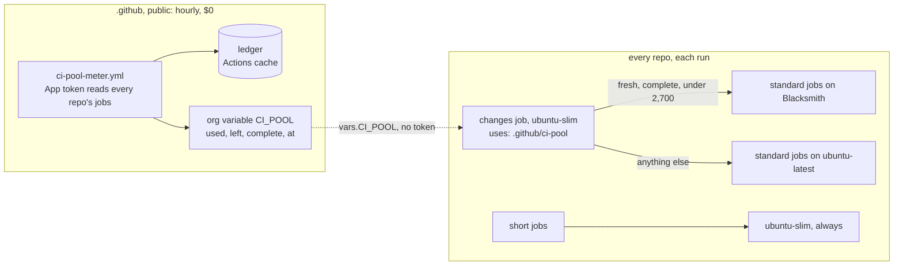

# ci-pool

One pool of free CI for every Colorado Startups repo. Paul, 2026-11-03: "No one repo gets assigned the minutes."
Free tiers and included minutes only, never pay-per-use on a card (Paul, 2026-11-02). The house rule is
`~/.claude/rules/compute.md` (canonical: Code-OS `rules/compute.md`); where it and this page disagree, the rule wins.

## The rules

| Job | Runner | Why |
| --- | --- | --- |
| Short: seconds of shell, git, an API call; under 15 min | `ubuntu-slim`, always | Linux 1-core bills $0.002 a minute, 2-core $0.006 ([GitHub runner pricing](https://docs.github.com/en/billing/reference/actions-runner-pricing), read 2026-11-03). A free Blacksmith minute saves three times as much on a standard job |
| Standard, pool under the stop | `blacksmith-2vcpu-ubuntu-2404` | Free: 3,000 x64 2-vCPU minutes a month per org ([Blacksmith overview](https://docs.blacksmith.sh/blacksmith-runners/overview)) |
| Standard, `arch: arm`, pool under the stop | `blacksmith-2vcpu-ubuntu-2404-arm` | An ARM minute counts 0.625 (same page), so the pool lasts longer |
| Standard, anything unread | `ubuntu-latest` | Unknown never means Blacksmith past free |
| `CI_RUNNER` set to a standard label | that label | The off switch. A Blacksmith or other label there is ignored |

| Reading | Chooser |
| --- | --- |
| `CI_POOL` empty, not JSON, not version 1 | GitHub-hosted |
| `at` older than 3 h, or more than 10 min ahead | GitHub-hosted |
| `complete` not `true` (a pass ran out of reads) | GitHub-hosted |
| `blacksmith.used` missing, negative, not a number | GitHub-hosted |
| `blacksmith.used` at or past the stop, a goal of 2,700 (90% of Blacksmith's 3,000) | GitHub-hosted |
| fresh, complete, under the stop | Blacksmith |

The margin between the stop and Blacksmith's free minutes covers what the meter cannot see in time: up to an hour between
readings, runs still going, and a re-run of an old run past the newest page.

## The meter

| Step | What |
| --- | --- |
| Window | Rolling 31 days, from 2026-10-31 at the earliest (the Blacksmith app's install day). Covers any reset day |
| Count | Every Blacksmith job of every attempt (`filter=all`), rounded up to a whole minute, times the label's weight (vCPU / 2, ARM 0.625). An unknown Blacksmith label is unreadable: no write |
| Reads | Org repos, each repo's newest runs until a page has nothing new, then each new run's jobs. At most 3,000 job lists a pass; past that the reading says `complete: false` |
| GitHub side | This month's gross Actions use from the billing API, against the included amount ($300 per the billing API, 2026-11-03). `days_left` is at the latest full day's use. Unreadable gives `could_not_check` and never blocks the Blacksmith reading |
| Misrouted | Jobs in the latest run of each workflow that ran on the wrong runner. Four cases: a short job on a 2-core runner; a standard job on GitHub-hosted while the pool has minutes; Blacksmith past the stop; a larger, macOS, Windows or self-hosted runner |
| Fails | Exit 3 and `CI_POOL` left as it was. Three hours later the chooser calls it stale |

Blacksmith has no public usage API. Its CLI's `blacksmith usage --since 30d --breakdown-by repo` ([Blacksmith CLI
usage](https://docs.blacksmith.sh/blacksmith-cli/usage.md)) needs an org token and a downloaded binary, so it is the
monthly cross-check, not the source.

## What Paul creates (Paul's queue)

The meter needs one GitHub App, because a repo's `GITHUB_TOKEN` reads only its own repo. Default name
`colorado-startups-ci-pool`. Until it exists, `CI_POOL` stays empty and every repo stays on GitHub-hosted.

| # | Where | What |
| --- | --- | --- |
| 1 | github.com/organizations/Colorado-Startups/settings/apps/new | Name `colorado-startups-ci-pool`. Webhook off. Only this account may install it |
| 2 | Same page, Repository permissions | **Actions: Read**. Metadata: Read (required) |
| 3 | Same page, Organization permissions | **Variables: Read and write** (writes `CI_POOL`). **Administration: Read** (the billing usage call; leave it off and the GitHub side reads `could_not_check`) |
| 4 | The App's page, Install App | Install on Colorado-Startups, **All repositories** |
| 5 | The App's page, Private keys | Generate a private key |
| 6 | Colorado-Startups/.github, Settings, Environments | New environment `ci-pool-meter`, deployment branches: `main` only. Add secret `CI_POOL_APP_KEY` (the key file's contents) |
| 7 | Colorado-Startups/.github, Settings, Variables | Repository variable `CI_POOL_APP_CLIENT_ID`, the App's Client ID |
| 8 | Colorado-Startups/.github, Actions | Run `ci-pool-meter` once (Run workflow) |

Nothing else needs a token. Every repo reads `vars.CI_POOL` from the org.

## Rollout order

Until a repo's own minute guard is gone, the pool cannot see its share. Source: legallas's `build_minutes_guard.py`
holds shares of 1,800 (legallas) and 900 (legallas-pro). Beside them, a third repo on the pool could take Blacksmith past
free. So legallas and legallas-pro switch to this chooser first, or together with the first other repo; no repo uses the pool alongside a
per-repo guard.

## Files

| File | What it is |
| --- | --- |
| [`ci_pool.py`](ci_pool.py) | Every rule: `choose`, `changes`, `meter` and `--self-test` (seeded known-good and known-bad cases) |
| [`action.yml`](action.yml) | The step a repo's change-detection job runs: runner and run, both always set |
| [`../.github/workflows/ci-pool-meter.yml`](../.github/workflows/ci-pool-meter.yml) | The hourly meter |
| [`../.github/workflows/self-test.yml`](../.github/workflows/self-test.yml) | The self-test, then the action as a repo calls it, with a known-good and a known-bad reading |

Exit codes: 0 done, 2 usage error, 3 could not check. `choose` and `changes` always exit 0, so the pool never fails a
run; a caller still falls back with `${{ needs.changes.outputs.runner && fromJSON(needs.changes.outputs.runner) ||
'ubuntu-latest' }}`.
