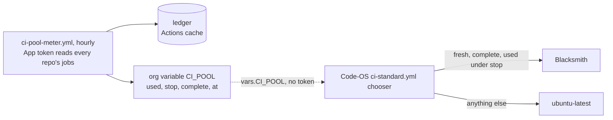

# ci-pool

The org's Blacksmith pool meter. Paul, 2026-11-04: Blacksmith's free tier takes the Colorado Startups org's CI
overflow ([code-os#200](https://github.com/Colorado-Startups/code-os/issues/200)). Free tiers and included minutes
only, never pay-per-use on a card (Paul, 2026-11-02). The house rule is `~/.claude/rules/compute.md` (canonical:
Code-OS `rules/compute.md`); where it and this page disagree, the rule wins. The chooser that reads the meter is a job
in Code-OS's `ci-standard.yml`; this folder only measures.

## Blacksmith, as read on 2026-11-04

| Fact | Value | Source |
| --- | --- | --- |
| Free minutes | 3,000 x64 2-vCPU minutes a month, per organization | [runners overview](https://docs.blacksmith.sh/blacksmith-runners/overview), [pricing](https://www.blacksmith.sh/pricing) |
| Card | "No credit card required" to start | pricing |
| Past free | Not stated. Ubuntu x64 lists $0.004 a minute | pricing |
| Labels | `blacksmith-{2,4,8,16,32}vcpu-ubuntu-2404`, `-arm` for ARM | runners overview |
| Weights | x64 counts vCPU / 2; ARM 0.625 of that; Windows 2; macOS 6-vCPU 20 | runners overview |
| Concurrency | "Blacksmith has no concurrency limits" | [concurrency](https://docs.blacksmith.sh/blacksmith-runners/concurrency) |

No concurrency limit means nothing on Blacksmith's side bounds an hour's burn, so the stop must.

## The stop

The chooser trusts a reading for `max_age_minutes`. Over that time the org can burn up to its peak hourly rate before
the next reading lands. So the stop sits that far under the free minutes.

| Term | Value | Why |
| --- | --- | --- |
| `MAX_AGE` | 75 minutes | One hourly pass, plus 15 minutes of schedule delay. A missed pass goes stale |
| Peak hour | Busiest hour in the window, at least 600 | The floor is a goal: about 1.65 times 8,709 Linux minutes / 24 h, the org's busiest day (2026-11-02, billing usage API, read 2026-11-04). The API no longer reads by hour |
| Stop | 3,000 minus 1.25 h times the peak | 2,250 at the floor. A busier hour lowers it |

## The meter

| Step | What |
| --- | --- |
| Window | Rolling 31 days, from 2026-10-31 at the earliest (the Blacksmith app's install day). Covers any reset day |
| Runs | Each repo's run list with no `created` filter, which caps a list at 1,000 runs. Paging ends at the first run older than the window. A list that ends short of `total_count` before that sets `complete: false` |
| Jobs | Every job of every attempt (`filter=all`), rounded up to a whole minute, times the label's weight. A job list short of its `total_count` sets `complete: false`. An unknown Blacksmith label (Windows, macOS) is unreadable: no write |
| Ledger | Finished runs whose jobs were all read, by run and `updated_at`, so a re-run is read again. At most 3,000 job pages a pass; past that, `complete: false` |
| Fails | Exit 3 and `CI_POOL` left as it was. 75 minutes after its `at`, the chooser calls it stale |

Blacksmith has no public usage API. Its CLI's `blacksmith usage --since 30d --breakdown-by repo` needs an org token, so
it is the monthly cross-check, not the source.

## The reading (`CI_POOL`, version 2)

| Field | Chooser rule |
| --- | --- |
| `version` | Exactly 2, or GitHub-hosted |
| `at` | Older than `max_age_minutes`, or more than 10 minutes ahead: GitHub-hosted |
| `complete` | Not `true`: GitHub-hosted |
| `blacksmith.used`, `blacksmith.stop` | Used at or past stop, or either not a number: GitHub-hosted |
| `blacksmith.peak_hour`, `left`, `by_repo`, `repos` | Shown, not used to choose |

## What Paul creates (Paul's queue, after merge)

The meter needs one GitHub App, because a repo's `GITHUB_TOKEN` reads only its own repo. Until it exists, `CI_POOL`
stays empty and every job stays on GitHub-hosted.

| # | Where | What |
| --- | --- | --- |
| 1 | blacksmith.sh | Sign up with GitHub, and install the Blacksmith GitHub App on Colorado-Startups |
| 2 | github.com/organizations/Colorado-Startups/settings/apps/new | Name `colorado-startups-ci-pool`. Webhook off. Only this account may install it |
| 3 | Same page | Repository: **Actions: Read** (Metadata: Read comes with it). Organization: **Variables: Read and write**. Nothing else |
| 4 | The App's page | Install App on Colorado-Startups, **All repositories**. Then generate a private key |
| 5 | Colorado-Startups/.github, Settings, Environments | New environment `ci-pool-meter`, deployment branches `main` only. Secret `CI_POOL_APP_KEY`: the key file's contents |
| 6 | Colorado-Startups/.github, Settings, Variables | Repository variable `CI_POOL_APP_CLIENT_ID`: the App's Client ID |
| 7 | Colorado-Startups/.github, Actions | Run `ci-pool-meter` once |

GitHub offers org Variables only as read and write, so the key could rewrite any org variable. The key lives only in
the main-only environment, and no `pull_request_target` workflow runs here.

## Files

| File | What it is |
| --- | --- |
| [`ci_pool.py`](ci_pool.py) | The meter and `--self-test` (fake APIs, one capped at 1,000 runs) |
| [`../.github/workflows/ci-pool-meter.yml`](../.github/workflows/ci-pool-meter.yml) | The hourly meter |
| [`../.github/workflows/self-test.yml`](../.github/workflows/self-test.yml) | Runs the self-test on every change here |

Exit codes: 0 done, 2 usage error, 3 could not check.
