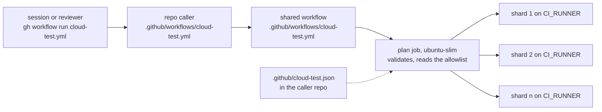

# cloud-test

No Colorado Startups repo tests, builds or renders on the MacBook Air (Paul, 2026-11-02). Every run goes to a hosted
runner through one shared workflow. The house rule is `~/.claude/rules/compute.md` (canonical source: Claude-OS
`rules/compute.md`); where it and this page disagree, the rule wins and this page gets fixed.



| File | What it is |
| --- | --- |
| [`.github/workflows/cloud-test.yml`](../.github/workflows/cloud-test.yml) | The reusable workflow (`workflow_call`). Wires runners to the script below and holds no rules of its own |
| [`cloud-test/cloud_test.py`](cloud_test.py) | The one definition: input and allowlist validation, the shard plan, the run and its job summary, and a `--self-test` |
| [`.github/actions/setup/action.yml`](../.github/actions/setup/action.yml) | The composite setup: Node from a version or `.nvmrc`, `node_modules` cached on the lockfile, Python and pip |
| [`workflow-templates/cloud-test.yml`](../workflow-templates/cloud-test.yml) | The caller every repo copies, with `pull_request` and `workflow_dispatch` |
| [`.github/workflows/self-test.yml`](../.github/workflows/self-test.yml) | This repo's own CI: the self-test, then a two-shard smoke run through the shared workflow |

## Adopt it in a repo

1. Copy `workflow-templates/cloud-test.yml` to `.github/workflows/cloud-test.yml`. Pin `uses:` to a full commit SHA of
   this repo's `main`, set the default `script`, and set `node-version` or `python` when the repo needs one.
2. Add `.github/cloud-test.json`, the allowlist (format below). A dispatch can reach only the names in it.
3. Take every test, build and render out of the repo's git hooks. Cheap guards stay: lints, secret scans, contract
   checks and the refusal to push to `main`.

Then a session runs a suite with:

```bash
gh workflow run cloud-test.yml -f ref=<sha or branch> -f script=<name> -f shards=<1 to 8>
```

The ref must contain `.github/cloud-test.json`, so a branch cut before the caller merged needs `main` merged in.

## The allowlist

`.github/cloud-test.json` in the caller repo:

```json
{
  "version": 1,
  "node_modules": ["node_modules", "site/node_modules"],
  "pip": ["requirements.txt"],
  "scripts": {
    "verify": { "run": ["bash", "tools/verify.sh"] },
    "test:unit": { "run": ["npm", "run", "test:unit"], "shard": ["--", "--shard={index}/{total}"] },
    "test:e2e": {
      "run": ["npm", "run", "test:e2e"],
      "shard": ["--", "--shard={index}/{total}"],
      "before": [["npx", "playwright", "install", "--with-deps", "chromium"]],
      "cache": ["~/.cache/ms-playwright"],
      "timeout": 30
    },
    "render": { "run": ["python3", "build.py"], "cwd": "deliverables", "pip": ["deliverables/requirements.txt"], "artifacts": ["deliverables/out/"] }
  }
}
```

| Key | Meaning |
| --- | --- |
| `version` | Always `1` |
| `node_modules` | Paths cached on the lockfile when `package-lock.json` exists. Default `["node_modules"]` |
| `pip` | Requirement files installed with pip before every script. The caller must pass `python` when any apply |
| `scripts.<name>` | A name that matches `[a-z0-9][a-z0-9:._-]{0,63}` |
| `run` | The command, as an argv list. No shell reads it, so `;`, `\|` and `$(...)` are plain characters |
| `shard` | Arguments appended when a run has more than one shard. `{index}` and `{total}` are filled in. Without it the script runs as one job. Every shard also gets `CLOUD_TEST_SHARD_INDEX` and `CLOUD_TEST_SHARD_TOTAL` |
| `before` | Commands run first, in order, each an argv list |
| `cwd` | The folder `before` and `run` start in, relative to the checkout. Default the checkout root |
| `pip` (in a script) | More requirement files, installed only for this script |
| `cache` | Extra paths cached for this script, keyed on the lockfiles. `~/` is allowed |
| `artifacts` | Paths uploaded after the run, kept 7 days. How a render comes back |
| `timeout` | Minutes for each shard, 1 to 60. Default 20 |

Paths are relative to the checkout, with no `..` and no leading `-`. `cloud_test.py check --allowlist=FILE` validates
a file; an invalid one fails the plan job with exit 2.

## Runners

Every shard runs on the `CI_RUNNER` variable: the caller repository's value, else the organization's, else
`ubuntu-latest`. So one organization variable moves every repo at once. The value is a plain label
(`ubuntu-24.04`) or JSON (`"ubuntu-latest"`, `["label", "label"]`, `{"group": "name"}`).

legallas's `ci.yml` reads the same variable as its off switch, as JSON only, and ignores a value that names
Blacksmith. Set the organization value as JSON so both read it alike.

legallas's `.github/scripts/build_minutes_guard.py` says Blacksmith's free tier is 3,000 minutes a month per org.
The same file says legallas and legallas-pro hold 2,700 of those minutes between them (read 2026-11-02). So the plan
job warns when `CI_RUNNER` names Blacksmith: another repo needs a share from the compute plan before it moves there.

The plan job takes seconds and always runs on GitHub-hosted `ubuntu-slim`, as legallas's `choose-runner` does.

## Exit codes

| Code | Meaning |
| --- | --- |
| 0 | Passed |
| 2 | Usage error: a bad ref, script, shard count or allowlist. Never a test failure |
| 3 | Could not run: a command would not start |
| other | The command's own exit code |

## Security

- A caller passes a name, and only names in its own allowlist run. Each command is an argv list, never a shell string.
- Inputs reach a shell only through `env:`, and `cloud_test.py` validates each one before anything uses it. A ref
  that starts with `-` or holds `..` never reaches git.
- The token is `contents: read`, the workflow takes no secrets, and every action is pinned to a full SHA.
- Each job checks `cloud_test.py` and the setup action out of this repo at `job.workflow_sha`, the commit the caller
  pinned. A caller's pin covers every file that runs.
- The allowlist and its commands come from the tested ref. Anyone who can push that ref can already change its
  workflows, so the allowlist bounds what a dispatch input can reach, not what a branch can run.
