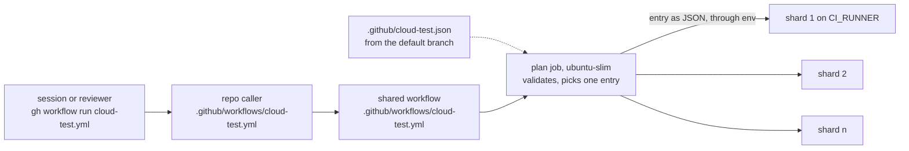

# cloud-test

Cloud first, the Mac last and small (Paul, 2026-11-02). Test suites, builds, browsers, e2e runs and every render or
GPU job run on hosted runners; the MacBook Air runs only rare, seconds-long checks, such as one test file or one
lint. Every Colorado Startups repo reaches the cloud through one shared workflow. The house rule is
`~/.claude/rules/compute.md` (canonical source: Code-OS `rules/compute.md`); where it and this page disagree, the
rule wins and this page gets fixed.



| File | What it is |
| --- | --- |
| [`.github/workflows/cloud-test.yml`](../.github/workflows/cloud-test.yml) | The reusable workflow (`workflow_call`). Wires runners to the script below and holds no rules of its own |
| [`cloud-test/cloud_test.py`](cloud_test.py) | The one definition: input, runner and allowlist validation, the shard plan, the run and its job summary, and a `--self-test` |
| [`.github/actions/setup/action.yml`](../.github/actions/setup/action.yml) | The composite setup: Node from a version or `.nvmrc` with `npm ci` on npm's download cache, Python and pip |
| [`workflow-templates/cloud-test.yml`](../workflow-templates/cloud-test.yml) | The caller every repo copies, with `pull_request` (path-filtered) and `workflow_dispatch` |
| [`.github/workflows/self-test.yml`](../.github/workflows/self-test.yml) | This repo's own CI: the self-test, then a two-shard smoke run through the shared workflow |

## Adopt it in a repo

1. Copy `workflow-templates/cloud-test.yml` to `.github/workflows/cloud-test.yml`. Pin `uses:` to a full commit SHA of
   this repo's `main`, set the default `script`, and set `node-version` or `python` when the repo needs one.
2. Add `.github/cloud-test.json`, the allowlist (format below). A dispatch can reach only the names in it.
3. Take every full test suite, build and render out of the repo's git hooks. Cheap guards and lints that take
   seconds stay: lints of changed files, secret scans, contract checks, the refusal to push to `main`.
4. Add the compute line and the gate-table row below to the repo's `CLAUDE.md`.

The compute line, near the repo's testing or gates section:

```markdown
**Compute:** cloud first, the Mac last and small (Paul, 2026-11-02). CI, test suites, builds, browsers, e2e, renders and GPU jobs run in the cloud (`.github/workflows/cloud-test.yml` here). The MacBook Air runs only rare, seconds-long checks, such as one test file or one lint. House rule: `~/.claude/rules/compute.md` (canonical: Code-OS `rules/compute.md`), which wins any disagreement.
```

The gate-table row, in the table that says which gates fire and which wait:

```markdown
| GitHub Actions `cloud-test` (`.github/workflows/cloud-test.yml`, a caller of the shared workflow in Colorado-Startups/.github) | **Waits** for a dispatch: `gh workflow run cloud-test.yml --ref <branch> -f script=<name>` runs a name from `.github/cloud-test.json` on a hosted runner. **Fires** on a pull request that changes the caller or the allowlist | No, advisory |
```

Then a session runs a suite with:

```bash
gh workflow run cloud-test.yml --ref <branch> -f script=<name> -f shards=<1 to 8>
```

`--ref` picks the branch whose caller runs; that branch's code is what gets tested. `-f ref=<sha>` tests another
commit instead, with the default branch's allowlist.

## The allowlist

`.github/cloud-test.json` in the caller repo. The plan job reads it from the default branch, or on a pull request
from the merge commit the caller itself came from. A dispatched `ref` never supplies it, so a new entry works by
dispatch only after it merges. The plan job passes the one entry it validated to the shards as JSON through env; no
shard reads an allowlist file from the code under test.

```json
{
  "version": 1,
  "pip": ["requirements.txt"],
  "scripts": {
    "verify": { "run": ["bash", "tools/verify.sh"] },
    "test:unit": { "run": ["npm", "run", "test:unit"], "shard": ["--", "--shard={index}/{total}"] },
    "test:e2e": {
      "run": ["npm", "run", "test:e2e"],
      "shard": ["--", "--shard={index}/{total}"],
      "before": [["npx", "playwright", "install", "--with-deps", "chromium"]],
      "timeout": 30
    },
    "render": { "run": ["python3", "build.py"], "cwd": "deliverables", "pip": ["deliverables/requirements.txt"], "artifacts": ["deliverables/out/"] }
  }
}
```

| Key | Meaning |
| --- | --- |
| `version` | Always `1` |
| `pip` | Requirement files installed with pip before every script. The caller must pass `python` when any apply |
| `scripts.<name>` | A name that matches `[a-z0-9][a-z0-9:._-]{0,63}` |
| `run` | The command, as an argv list. No shell reads it, so `;`, `\|` and `$(...)` are plain characters. No argument may hold a line break |
| `shard` | Arguments appended when a run has more than one shard. `{index}` and `{total}` are filled in. Without it the script runs as one job. Every shard also gets `CLOUD_TEST_SHARD_INDEX` and `CLOUD_TEST_SHARD_TOTAL` |
| `before` | Commands run first, in order, each an argv list |
| `cwd` | The folder `before` and `run` start in, relative to the checkout. Default the checkout root |
| `pip` (in a script) | More requirement files, installed only for this script |
| `artifacts` | Paths relative to the checkout root, uploaded after the run and kept 7 days. How a render comes back |
| `timeout` | Minutes for each shard, 1 to 60. Default 20 |

Paths are relative to the checkout, with no `..`, no leading `-`, `/` or `~`. `cloud_test.py check --allowlist=FILE`
validates a file; an invalid one fails the plan job with exit 2.

## Runners and money

Free tiers and included minutes only (Paul, 2026-11-02). Every shard runs on the `CI_RUNNER` variable, the caller
repository's value or else the organization's, so one organization variable moves every repo at once. It is a
plain label, the form every other workflow reads as `${{ vars.CI_RUNNER || 'ubuntu-latest' }}`; unset, it is
`ubuntu-latest`.

`cloud_test.py` accepts the standard GitHub-hosted Linux labels the included minutes cover (`ubuntu-latest`,
`ubuntu-24.04`, `ubuntu-22.04`, `ubuntu-slim`). It refuses larger runners, which bill per minute, and self-hosted
labels and runner groups. A `blacksmith-*` label passes with a warning: Blacksmith's free tier needs Paul's yes and
an account that stops at the free limit.

The plan job takes seconds and always runs on GitHub-hosted `ubuntu-slim`. Every job has a timeout; the caller adds
`concurrency` that cancels a pull request's older run, and a path filter so other pull requests spend nothing.

## Caches

The plan job has no cache access (`cache-mode: none`) and every shard may only restore (`cache-mode: read`). So code
under test can never write a cache that a later run restores. There is no `node_modules` cache: `npm ci` always
runs, on npm's download cache. A repo's own workflows on `main`, which run reviewed code, are what fill the npm and
pip caches the shards restore.

## Exit codes

| Code | Meaning |
| --- | --- |
| 0 | Passed |
| 2 | Usage error: a bad ref, script, shard count, runner or allowlist. Never a test failure |
| 3 | Could not run: a command would not start, or the GitHub API could not be read |
| other | The command's own exit code |

## Security

- A caller passes a name, and only names in its default branch's allowlist run. Each command is an argv list, never
  a shell string.
- Inputs reach a shell only through `env:`, and `cloud_test.py` validates each one before anything uses it. A ref
  that starts with `-` or holds `..` never reaches git; a branch name resolves to one commit for every shard.
- The token is `contents: read`, the workflow takes no secrets, and every action is pinned to a full SHA.
- Each job checks `cloud_test.py` and the setup action out of this repo at `job.workflow_sha`, the commit the caller
  pinned. A caller's pin covers every file that runs. The plan job refuses a caller in another repo that pins a
  branch or tag (`job.workflow_ref` ending in `refs/heads/` or `refs/tags/`), and warns on any form it cannot read.
- Anyone who can push a branch can already change that branch's workflows. The allowlist bounds what a dispatch
  input reaches from the default branch's caller, not what a branch's own code does.
